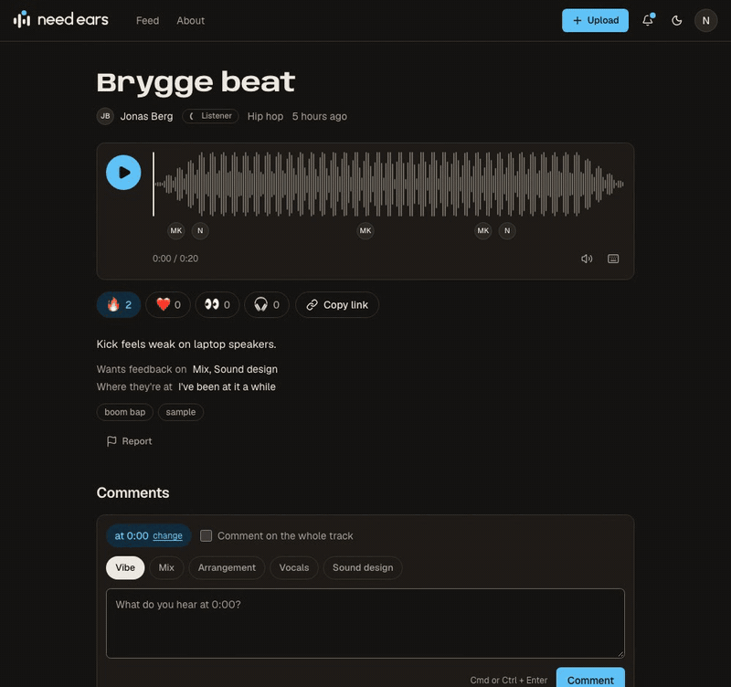
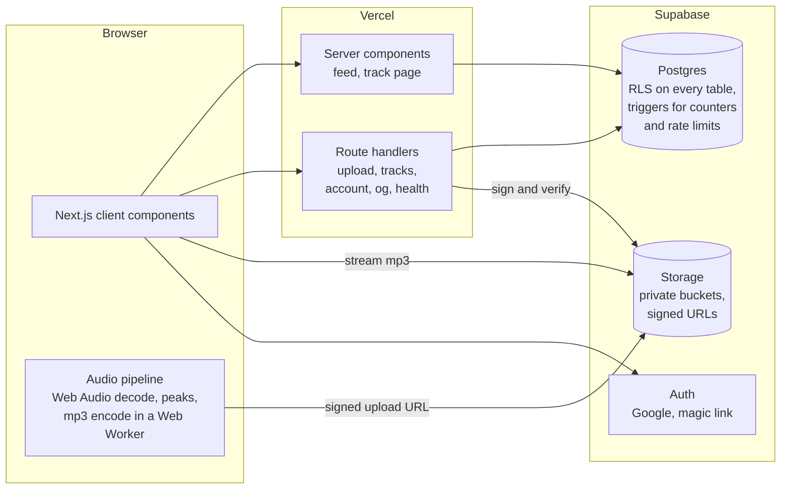

<div align="center">

# Need Ears

**Upload an unfinished track. Get comments at the exact second.**

[](https://github.com/braenden/needears/actions/workflows/ci.yml)
[](LICENSE)

**Live site: [needears.com](https://needears.com)**



</div>

Need Ears is a free, open feed where music producers post tracks that are still in progress, and other producers leave comments pinned to the waveform: "vocal gets buried at 1:42", "love this drop", "kick and bass fight here". Anyone can listen without an account.

## Why

When you've heard your track 400 times, you stop hearing it. The places to get fresh ears all fall short:

- **Music sites** have comments, but they are mostly "fire" and 🔥.
- **Forums** can give honest feedback, but there is no player with timestamps, and threads sink in a day.
- **Paid review tools** have the right player, but they are closed, paid and made for client work, not for a community.

Need Ears puts honest feedback from other producers in a player that lets people comment on the exact moment. It is free and open source.

## Features

- **Timestamped comments** on the waveform, with markers, click to jump, and a category on each comment (Vibe, Mix, Arrangement, Vocals, Sound design).
- **Say what you want feedback on** when you upload, so a beginner can ask about the overall vibe and a veteran about the low end.
- **Helpful marks and reputation.** The uploader marks comments as Helpful, and that is the only way to earn reputation (New ear, Listener, Trusted ear, Golden ear). It comes from helping, not from posting a lot.
- **A feed that rewards giving.** Needs ears, Latest and Trending. The ranking is in the open: people who recently gave Helpful feedback get a small lift.
- **Reactions**, keyboard shortcuts, dark and light theme, works on a phone, Lighthouse Accessibility 100.
- **Reporting and moderation**, a copyright takedown process and community guidelines.
- **Download your data** and delete your account at any time.

## How it works

Everything runs on Next.js and Supabase. There is no media server.

**Audio is processed in your browser.** The Web Audio API decodes the file and computes the waveform peaks. If it isn't an mp3, an encoder (lamejs) in a Web Worker turns it into a 192 kbps mp3 while you fill in the details. The browser uploads straight to Supabase Storage with a signed URL, and the server checks the object before it creates the track.

**The database is the security boundary.** Every table has Row Level Security: reading live content is open, writing is limited to your own rows, and only the uploader can mark a comment Helpful. Counters, reputation and rate limits live in Postgres triggers, so the client can't skip them. The policies are tested with pgTAP in CI.

**The front end** uses React Server Components for the feed and track pages (fast first paint, good for search), Tailwind v4 and shadcn/ui, and wavesurfer.js with a custom marker layer.



## Run it locally

You need Node 24, pnpm (`corepack enable`), Docker and the [Supabase CLI](https://supabase.com/docs/guides/local-development/cli/getting-started).

```bash
git clone https://github.com/braenden/needears.git && cd needears
pnpm install
supabase start                 # Postgres, Auth, Storage and Mailpit, with seed data
cp .env.example .env.local     # paste the URL and keys from `supabase status`
pnpm dev                       # http://localhost:3000
```

Sign in with a magic link: the email lands in Mailpit at http://127.0.0.1:54424. The seed has three users (`nora@example.com`, `jonas@example.com` and the admin `mia@example.com`), ten short tracks and thirty comments. The local ports (544xx) are moved from the Supabase defaults so Need Ears can run next to other Supabase projects. `pnpm db:reset` rebuilds the database from the migrations and the seed.

## Tests

```bash
pnpm lint && pnpm typecheck && pnpm knip   # static checks
pnpm test                                   # Vitest unit and component tests
pnpm test:db                                # pgTAP: row level security, triggers, rate limits
pnpm build && pnpm test:e2e                 # Playwright: the main flow, security headers, and axe-core on six pages
pnpm test:lighthouse                        # Lighthouse budgets on the feed, a track and a profile
```

CI runs all of them on every pull request against a local Supabase in the runner, plus CodeQL and Gitleaks.

## Roadmap

**v1** (now): accounts, upload, track page, feed, profiles, Helpful and reputation, reactions, reporting and admin, settings and account deletion, legal pages.

**v1.1:** email summaries, realtime comments, a mini player that follows you around, following people, marking comments as resolved.

**v2:** versions of a track with A/B switching, exporting comments as DAW markers, collections and Feedback Friday, Norwegian, private links.

Not planned: audio analysis, direct messages, payments, a native app.

## Contributing

Contributions are very welcome. Start with [CONTRIBUTING.md](CONTRIBUTING.md) and the issues labelled [`good first issue`](https://github.com/braenden/needears/labels/good%20first%20issue). Please read the [Code of Conduct](CODE_OF_CONDUCT.md). To report a security problem, see [SECURITY.md](SECURITY.md) (you get an answer within 72 hours).

## License

The code is released under the [MIT license](LICENSE).

**The music and comments people upload to Need Ears are not covered by the MIT license.** They belong to the people who made them. See the [terms](https://needears.com/terms).

## Built by

[Kevin Brenden](https://github.com/braenden). I build tools for people who make music.
